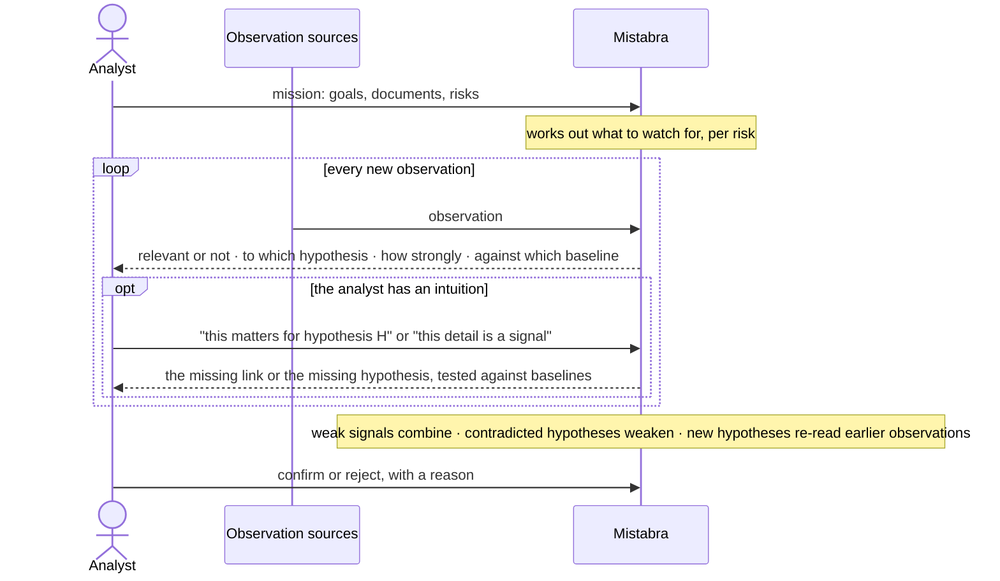

# Mistabra

**Analyst co-pilot turning intuition into reasoning.**

Experienced analysts know more than they can tell: their tacit knowledge flags an observation as significant long
before they can explain why. Mistabra treats that intuition as a first-class input. It builds the reasoning behind
it, and keeps testing it, alongside alternative hypotheses, against every new observation.

> **Research preview (0.x).** The API may still change. The method is measured on synthetic cases only, not yet on
> real analyst work; see [Results](#results) and [Limitations](#limitations).

## How it works: who does what



| | The analyst | Mistabra |
| --- | --- | --- |
| **Set up** | describes the mission: goals, documents, risks | works out what to watch for under each risk |
| **Observations arrive** | reviews them and raises an intuition: "this matters for H", or "this detail is a signal" | assesses each observation against all hypotheses; for an intuition, articulates the reasoning behind it |
| **Over time** | adds or drops hypotheses | combines weak signals, weakens contradicted hypotheses, proposes new ones, re-reads earlier observations against them |
| **Decide** | confirms or rejects, and says why | records who, when and why, alongside what it said at the time |

Mistabra proposes; the analyst decides.

## Two key ideas

**Intuition is an input.** The analyst does not need to justify an intuition before submitting it:

- *"This observation matters for hypothesis H, I can't say why."* Mistabra articulates the connecting signal: a
  **Lambda signal**.
- *"This detail is a signal, I don't know of what."* Mistabra proposes the hypothesis behind it: a **Lambda
  hypothesis**, when no existing one fits.

Mistabra may also raise both on its own, when an observation points somewhere nobody has looked.

**Every hypothesis must beat its baselines, and Mistabra writes them itself.** Weighing competing hypotheses is
established practice, but the analyst usually chooses which alternatives to list, and the ones we don't think of are
the ones that trap us. Mistabra creates the ordinary explanation of the same facts for every hypothesis an
observation supports, and a signal counts only by how much better it fits. This is what keeps the first idea honest:
reasoning built for an intuition without a challenge would only make confirmation bias more convincing.

## Terms

| Term | Meaning |
| --- | --- |
| Observation | one incoming piece of information (`Episode` in the code) |
| Risk | the outcome to prevent or detect |
| Hypothesis | a possible explanation that leads toward a risk |
| Signal | what in an observation bears on a hypothesis |
| Baseline | the ordinary explanation of the same facts |
| Trajectory | observation → signal → hypothesis → risk, with its reasoning and a score |

## Why Mistabra

| | Chat assistant | ACH tools | Alerting rules | **Mistabra** |
| --- | --- | --- | --- | --- |
| Takes an analyst's unexplained intuition as input | ad hoc, if asked | no | no | **yes** |
| Generates alternative explanations itself, every time | if asked | analyst lists them | no | **yes, always** |
| Keeps weak signals and combines them | no | manual | thresholds | **yes** |
| Looks beyond the hypotheses already held | no | no | fixed rules | **yes** |
| Records reasoning and decisions | no | partly | alert log | **yes** |

## Quickstart

```bash
pip install -e ".[dev]"
cp .env.example .env              # provider, model, key (local models supported)
python examples/cold_store.py     # --offline runs it with a fake model: shows the flow, not the reasoning
```

```python
from mistabra.core import Core, Episode, Settings
from mistabra.casebook import Casebook

case = Casebook(Core(Settings.from_env()), mission, path="case.sqlite")   # mission: your documents and risks
h = case.add_hypothesis("Cold Room 2's controller loses power at night.", risk="spoilage")

# an observation arrives: Mistabra assesses it against every hypothesis
case.ingest(Episode(id="e1", text="Compressor service found all three units within spec."))

# an intuition: "this matters for h, I can't say why"
got = case.ingest(Episode(id="e3", text="A new night cleaning crew started in March; it works midnight to 4 a.m."),
                  hypothesis=h)
g = got.assessment.groups[0]
print(g.target.lambda_signal, g.target.signal, g.target.score)    # True, the signal Mistabra articulated, its score
print([b.hypothesis.claim for b in g.baselines])                  # the baselines it had to beat

case.confirm(got.trajectories[0], by="analyst", note="checked the socket")   # recorded with who, when and why
```

**The example** ([`examples/cold_store.py`](examples/cold_store.py)): a warehouse keeps losing chilled stock. The
analyst suspects the compressors or open doors. Eight observations arrive. Mistabra weakens both hypotheses and
proposes what nobody stated: the cleaners unplug Cold Room 2's controller at night to charge their scrubbers.

## Where it fits

Incident and quality investigations, fraud and compliance, supply-chain disruption, threat intelligence: anywhere
observations pile up, most mean nothing, and the few that matter often matter only together.

## Architecture

Two layers:

- **`mistabra.core`** assesses one observation at a time and keeps no state ([spec](docs/mistabra_core_api_v3.md)).
- **`mistabra.casebook`** keeps the case between calls, re-reads earlier observations when a new hypothesis appears,
  and records the analyst's decisions (SQLite or in memory).

Models: Anthropic, OpenAI, OpenRouter, or any OpenAI-compatible endpoint, including local servers (Ollama, vLLM,
llama.cpp) for data that must not leave your machine. Observations and mission documents are sent to the provider
you configure. Every model answer must fit a schema, and answers are cached by input.

## Results

Measured on the testbed on 2026-11-08 with Qwen 3.5 27B (reasoning) and Qwen 3.5 Flash (fast) through OpenRouter,
three independent runs. The cases are synthetic, written for the testbed; ranges are min-max over the runs.

| Capability | Measure | Result |
| --- | --- | --- |
| Separate signals from noise | labelled positives ranked above hard negatives (AUROC); false-signal rate | 0.98-1.0; 0 |
| Find the cause the analyst missed | 16 cases: same mechanism as the answer key / at least partly / reaching standing 0.5 | 11-14 / 15-16 / 9-10 |
| No false alarms | 6 control cases where nothing is missing: an established new cause | 0 in every run |
| Combine facts that only matter together | refuted vs supported analyst hypotheses (AUROC) | 1.0 |
| Combine weak signals | two weak observations reaching standing 0.4 together | 2 of 3 runs |
| Match instead of duplicating; stable under paraphrase; no build-up from noise | | pass in every run |

A full pass over the 38 scenarios takes about 10 minutes and 400 model calls; an irrelevant observation takes about
2 s, a relevant one about 15 s. How to run and extend the testbed: [docs/testbed.md](docs/testbed.md).

## Limitations

- **Synthetic evaluation.** The cases and answer keys were written by the developers. The numbers show whether a
  change helps or hurts; they do not show that the method is right on real work. A blinded evaluation with domain
  analysts has not been done yet.
- **Intuitions are checked, not yet measured.** The tests check that an analyst's intuition produces a Lambda signal
  or a Lambda hypothesis when it should; how often the articulated reasoning is right has not been measured.
- **Run-to-run variance.** Hosted models are not reproducible even at temperature 0: the same case can be solved in
  one run and missed in the next.
- **Not probabilities.** Scores order things by strength; the bands (weak from 0.2, strong from 0.4) are a convention
  calibrated on a small labelled set.
- **Known failure patterns.** A vague hypothesis formed early can absorb later, more specific evidence; a
  routine-looking first clue may be missed until a hypothesis gives it meaning.
- **Cost grows with risks.** Each risk is checked against each observation separately.

## Responsible use

Mistabra is a reasoning aid for analysts investigating systems, processes and incidents. A score, a standing or an
articulated hypothesis is a prompt for human judgment, never evidence on its own, and never a basis for action
against a person. Do not use it to profile or monitor individuals or groups, or to infer anything about a person's
beliefs, identity or intentions from their ordinary behaviour.

## Documentation

- [API spec](docs/mistabra_core_api_v3.md): the core layer's single call, its inputs and outputs
- [Testbed and code layout](docs/testbed.md): scenarios, metrics, how to run them, where things are

## License

[Apache License 2.0](LICENSE).
